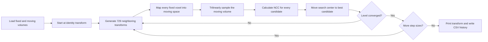

# Registration algorithm and expected output

## 1. Purpose

This project estimates a rigid transform that aligns a **moving** 3-D volume
with a **fixed** reference volume. A rigid transform has six parameters:

| Parameter | Meaning | Unit |
|---|---|---|
| `tx`, `ty`, `tz` | Translation along the voxel axes | voxels |
| `rx`, `ry`, `rz` | Euler rotation about the voxel axes | degrees |

The program maximizes normalized cross-correlation (NCC). It implements the same
objective and search in three ways:

1. `cpu_main.cpp`: standalone C++ CPU reference.
2. `main.cu`, CPU path: a second CPU reference used inside the CUDA comparison.
3. `main.cu`, GPU paths: naive CUDA and optimized CUDA evaluators.

The reported transform maps a coordinate in the fixed volume into the moving
volume. This direction matters when applying the result in another program.

## 2. Processing flow



## 3. Coordinate and transform convention

Volumes are stored with `x` changing fastest:

```text
index = (z * height + y) * width + x
```

Rotation occurs around the geometric center of the fixed volume:

```text
center = ((width - 1)/2, (height - 1)/2, (depth - 1)/2)
```

For a fixed-volume coordinate `p`, the corresponding moving-volume coordinate
is:

```text
moving_coordinate = R * (p - center) + center + translation
```

The rotation matrix uses column vectors and this order:

```text
R = Rz * Ry * Rx
```

Because matrix multiplication is ordered, changing the rotation order changes
the result. The printed angles should therefore be interpreted with this exact
convention.

## 4. Trilinear interpolation

A transformed coordinate usually lies between voxel centers. The program samples
the eight surrounding moving-volume voxels and linearly blends them along `x`,
then `y`, then `z`.

Coordinates outside the moving volume return zero. This is simple and
deterministic, but large rotations or translations create more zero-valued
samples near the boundary and can affect the NCC score.

## 5. Normalized cross-correlation

For each transform, the program accumulates five values over all `N` fixed
voxels:

```text
Sf  = sum(f)
Sm  = sum(m)
Sff = sum(f*f)
Smm = sum(m*m)
Sfm = sum(f*m)
```

Here `f` is a fixed voxel and `m` is the interpolated moving value. NCC is:

```text
              Sfm - Sf*Sm/N
NCC = ---------------------------------
      sqrt((Sff - Sf*Sf/N)(Smm - Sm*Sm/N))
```

Interpretation:

- `1` means perfect positive correlation.
- Values near `0` mean little linear correlation.
- `-1` means perfect inverse correlation.
- A constant volume has zero variance, so the implementation returns negative
  infinity for that candidate.

NCC is relatively insensitive to a global intensity offset or positive scale,
which is useful when the two images have different overall brightness.

## 6. Coarse-to-fine parameter search

The optimizer begins at the identity transform `(0,0,0,0,0,0)` and uses step
sizes `4`, `2`, and `1` in that order.

At every iteration, each of the six parameters can change by `-step`, `0`, or
`+step`. This creates:

```text
3^6 = 729 candidate transforms
```

The program evaluates all candidates, chooses the highest NCC, and uses that
transform as the next search center. Parameters are clamped to
`--max-translation` and `--max-rotation`.

A refinement level stops when:

- the best transform is unchanged;
- the score does not improve by more than `1e-12`; or
- ten iterations have run.

The next level then repeats the process with a smaller step. The final precision
is one voxel and one degree; this implementation does not estimate sub-voxel or
sub-degree parameters.

This is a local discrete search. A result on a configured boundary often means
the search range is too small. That occurred on the test NIfTIs with a ±12°
rotation bound, so the final benchmark used ±30°.

## 7. CPU and CUDA execution models

All backends evaluate the same candidates and NCC equation.

### Standalone C++ CPU

`cpu_main.cpp` evaluates candidates one at a time. For every candidate, it loops
over every fixed voxel, transforms its coordinate, samples the moving volume,
and updates the five NCC sums.

The approximate work per search iteration is:

```text
729 * width * height * depth voxel evaluations
```

### Naive CUDA

The naive CUDA kernel assigns one GPU thread to one candidate transform. Each
thread loops through the entire volume. This exposes candidate-level parallelism,
but each thread performs a long serial voxel loop.

### Optimized CUDA

The optimized kernel assigns one CUDA block to one candidate. Its 256 threads
divide the voxels, calculate partial NCC sums, and reduce five arrays in shared
memory. Thread 0 produces the candidate's final NCC score.

This strategy exposes both candidate and voxel parallelism and was substantially
faster on the RTX 3060 benchmark.

## 8. Input modes

### Synthetic mode

Running an executable without input paths creates a reproducible `64 x 64 x 64`
volume from nine Gaussian blobs. A moving volume is generated with known truth:

```text
translation = (3, -2, 1)
rotation    = (4, -3, 2)
```

The output includes a combined parameter error. The program defines it as the
translation-vector error plus the rotation-vector error. Since it adds voxels
and degrees, it is a diagnostic number rather than a physical distance.

### Raw float32 mode

The native executables accept two equal-sized, headerless float32 files. Each
file must contain exactly:

```text
width * height * depth * 4 bytes
```

### NIfTI runner

`run_nifti_registration.py` converts single-file NIfTI-1 `.nii` or `.nii.gz`
images to little-endian float32 raw files and calls both native executables. It
also writes conversion metadata and a JSON comparison.

The native registration uses voxel coordinates. It does not use the NIfTI affine,
orientation metadata, or physical spacing. The runner records that metadata so
the assumption remains visible.

For the supplied test data, `--stride 8` changes the volume from
`384 x 144 x 512` at 0.5 mm spacing to `48 x 18 x 64` at an effective 4 mm
spacing. Translations reported by that run are measured in these downsampled
voxels.

## 9. Expected console output

### Self-tests

The self-tests are small deterministic checks compiled into the executables. They
run when `--self-test` is supplied and throw an error immediately when an
assertion fails. They do not load the test NIfTIs or run the full optimizer.

Run them with:

```powershell
.\build\Release\cpu_registration.exe --self-test
.\build\Release\cuda_registration.exe --self-test
```

#### 1. Integer-coordinate interpolation

The test creates a `3 x 3 x 3` volume containing the values `0` through `26` in
storage order. It samples coordinate `(1,1,1)`, whose stored value is `13`:

```text
sample_trilinear(volume, 1, 1, 1) = 13
```

The accepted absolute error is `1e-6`. Because the coordinate lies exactly on a
voxel center, this verifies indexing and the exact-coordinate path through the
trilinear interpolator. A failure usually indicates an incorrect 3-D index,
axis order, boundary calculation, or interpolation weight.

#### 2. Out-of-bounds interpolation

The same volume is sampled at `(-0.1,1,1)`. The x-coordinate is just outside the
volume, so the required result is exactly zero:

```text
sample_trilinear(volume, -0.1, 1, 1) = 0
```

This verifies the zero-padding rule used when a transform maps a fixed voxel
outside the moving volume. It tests one negative-x case; it does not separately
exercise all six faces or large positive coordinates.

#### 3. Identity NCC

The nonconstant `3 x 3 x 3` volume is compared with itself using the identity
transform `(0,0,0,0,0,0)`. The expected NCC is `1.0`, with an accepted absolute
error of `1e-12`:

```text
NCC(volume, volume, identity) = 1
```

This jointly checks identity coordinate mapping, interpolation at integer voxel
centers, accumulation of the five NCC sums, and the final NCC equation. It would
catch many indexing or formula errors, although it does not validate a rotated
or translated known solution.

#### 4. Constant-volume NCC (`cpu_main.cpp` only)

The CPU-only executable creates another `3 x 3 x 3` volume in which every value
is `1`. A constant image has zero variance, so the NCC denominator is zero. The
implementation uses negative infinity as the invalid-candidate score, and the
self-test verifies that the result is infinite:

```text
NCC(constant, constant, identity) = -infinity
```

This protects the optimizer from treating an undefined NCC as a useful match.
The assertion checks `isinf`; the NCC implementation itself produces negative
infinity.

#### 5. CPU/CUDA numerical agreement (`main.cu` only)

When a CUDA device is available, the CUDA self-test evaluates two transforms on
the nonconstant test volume:

```text
identity:       (0,0,0,0,0,0)
x translation: (1,0,0,0,0,0)
```

It calculates both scores with all three evaluators:

- CPU reference;
- naive CUDA, where one thread evaluates one complete transform; and
- optimized CUDA, where one block evaluates a transform and reduces partial
  sums in shared memory.

For each transform, both CUDA scores must differ from the CPU score by no more
than `1e-9`. This checks kernel launch and data transfer, device coordinate
mapping, device interpolation, NCC accumulation, and the optimized shared-memory
reduction. The translated candidate also exercises out-of-volume zero samples.

If no CUDA device is available, the program prints:

```text
CUDA test skipped: no CUDA device available.
```

The interpolation and CPU NCC checks still run, and the executable then reports
success. On the current RTX 3060 system, the CUDA comparison runs rather than
being skipped.

#### Successful output

After all standalone CPU assertions pass, the CPU executable prints:

```text
All CPU self-tests passed.
```

After its CPU and GPU assertions pass, the CUDA executable prints:

```text
All self-tests passed.
```

#### Compute Sanitizer check

Compute Sanitizer is an external NVIDIA diagnostic rather than a built-in
self-test. Run it with:

```powershell
& 'C:\Program Files\NVIDIA GPU Computing Toolkit\CUDA\v13.4\compute-sanitizer\compute-sanitizer.exe' `
  --tool memcheck .\build\Release\cuda_registration.exe --self-test
```

It observes the CUDA self-test while checking for reported device-memory access
errors. A successful run ends with:

```text
========= ERROR SUMMARY: 0 errors
```

That was the result on the current build.

#### What these tests do not cover

The built-in checks intentionally stay quick. They do not verify:

- recovery of a complete known six-parameter transform;
- the 729-candidate optimizer or its stopping rules;
- raw-file and NIfTI conversion correctness end to end;
- CSV/JSON output parsing;
- all interpolation boundaries and fractional-coordinate cases;
- numerical behavior on large or low-variance medical volumes; or
- registration quality against anatomical landmarks or expert ground truth.

The synthetic demo and the measured NIfTI CPU/CUDA comparison provide broader
integration evidence, but they are benchmarks rather than additional assertions.

### Standalone CPU result

The CPU executable prints one result line:

```text
CPU result: (tx,ty,tz)=(0.0000,0.0000,0.0000), (rx,ry,rz)=(-16.0000,-23.0000,26.0000), NCC=0.8881, median time=6014.4679 ms
History written to ...\cpp_history.csv
```

Field meanings:

| Field | Meaning |
|---|---|
| `tx,ty,tz` | Fixed-to-moving translation in voxels |
| `rx,ry,rz` | Fixed-to-moving Euler angles in degrees |
| `NCC` | Objective value at the selected transform |
| `median time` | Median complete registration time across `--repeats` |

The first repetition supplies the transform and history; all repetitions
contribute to the median time.

### CUDA comparison result

The CUDA executable prints the selected GPU and one line for each backend:

```text
GPU: NVIDIA GeForce RTX 3060
Volume: 48x18x64
CPU: (...) NCC=0.8881 wall=7769.8872 ms kernels=7769.7644 ms
Naive CUDA: (...) NCC=0.8881 wall=9954.6350 ms kernels=3234.6597 ms
Optimized CUDA: (...) NCC=0.8881 wall=1120.1388 ms kernels=374.1929 ms
CPU / optimized wall speedup: 6.9365x
Naive / optimized kernel speedup: 8.6444x
Max score difference, CPU vs naive: 0.0000
Max score difference, CPU vs optimized: 0.0000
```

`wall` includes candidate creation, copies, launches, result transfers, and the
requested repeated GPU evaluations. `kernels` is accumulated CUDA-event time,
using the median kernel time for each candidate batch. On the CPU line, the same
column contains accumulated CPU evaluation time even though the label says
`kernels`.

The score-difference lines are printed to four decimal places. The CSV and JSON
outputs retain more precision and should be used for detailed comparisons.

## 10. Measured test-NIfTI result

Command parameters:

```text
stride = 8
maximum translation = 12 voxels
maximum rotation = 30 degrees
repeats = 3
```

All four evaluated paths returned:

```text
translation = (0, 0, 0)
rotation    = (-16, -23, 26) degrees
NCC         = 0.888097702402
```

| Backend | Wall time | CUDA kernel time | Parameter/NCC agreement |
|---|---:|---:|---|
| Standalone C++ CPU | 6014.47 ms | n/a | Reference |
| `main.cu` CPU | 7769.89 ms | n/a | Exact |
| Naive CUDA | 9954.64 ms | 3234.66 ms | Exact |
| Optimized CUDA | 1120.14 ms | 374.19 ms | Exact |

The speedups reported by `main.cu` were:

```text
CPU / optimized wall speedup: 6.9365x
Naive / optimized kernel speedup: 8.6444x
```

The rotation no longer lies on the ±30° bounds, and the NCC improved from the
bounded ±12° run's `0.8192` to `0.888097702402`.

An NCC of about `0.888` indicates strong correlation under this objective. It
does not by itself prove anatomical correctness; visual inspection or landmark
error is still needed for registration validation.

## 11. CSV and JSON output

The native history CSV contains:

```text
backend,level,iteration,translation_step,rotation_step,tx,ty,tz,rx,ry,rz,ncc
```

Each row records the best candidate after one optimizer iteration. Useful checks
include:

- NCC should generally increase as the search advances.
- A parameter repeatedly equal to a bound suggests increasing that bound.
- CPU and CUDA histories should choose the same transforms or differ only from
  very small floating-point score changes.

The NIfTI runner additionally writes `registration_comparison.json`, containing:

- input and converted-volume metadata;
- the sampling stride and raw layout;
- parsed results for every backend; and
- the original console output.

## 12. Limitations when interpreting results

- The search is discrete and local; it can settle on a local maximum.
- There is no multiresolution image pyramid inside the native implementation.
- Voxels are treated as isotropic and NIfTI affines are ignored.
- Out-of-volume moving samples and masked background are both zero and both
  participate in NCC.
- Only rigid transforms are supported; there is no scale, shear, affine, or
  deformable registration.
- External input mode reports parameters and history but does not save a final
  resampled registered volume.
- Full-resolution exhaustive CPU registration of the supplied NIfTIs is much
  more expensive than the downsampled teaching benchmark.
